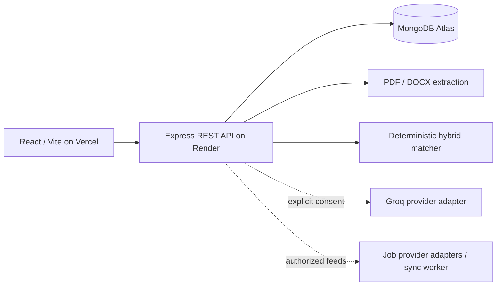

# ResumeIQ

AI Resume Matcher & Job Discovery — a MERN application built incrementally.

**Delivered: Milestones 1–5.** MongoDB-backed authentication plus private PDF/DOCX resume upload, real text extraction, editable structured previews, persisted corrections, resume library, and deletion. Explainable resume-to-job matching, saved results and history are now available. Groq-powered suggestions, conservative bullet edits, score previews and saved optimized versions are available. Authorized Jobicy discovery, local resume-based recommendations, filters, source details and private bookmarks are available. This is not yet the complete production product.

## Architecture



Frontend: React, JavaScript, Vite, Tailwind CSS, React Router, Axios, Lucide and Recharts. Backend: Node.js, Express, Mongoose, bcrypt, JWT cookies, Zod, Helmet, CORS, rate limiting, Pino. PDF/DOCX extraction uses pdf-parse and Mammoth, with Multer uploads, yauzl archive inspection, and saxes XML validation. Optional embedding support uses server-side fetch; Groq generation uses the official backend SDK; job discovery uses an hourly throttled, on-demand MongoDB cache.

## Initialize and run

Use Node 22.12+ and MongoDB 8 (local or Atlas). The project has already been initialized; do not run `create-vite` over it.

```sh
cd /Users/dsairushitha/Documents/resumeIQ
npm ci
# Only for a new setup; preserve existing environment files.
cp -n server/.env.example server/.env
cp -n client/.env.example client/.env
node -e "console.log(require('node:crypto').randomBytes(48).toString('hex'))"
```

Paste the generated value into `JWT_SECRET` in `server/.env`. Never commit this file. Start a local MongoDB service, or start only the database with `docker compose up -d mongo`. Set `MONGODB_URI` if using Atlas. Then:

```sh
npm run dev
```

Open [127.0.0.1:5173](http://127.0.0.1:5173). Set CLIENT_URL to this exact origin (the example now uses 127.0.0.1); using a different host can correctly trigger CSRF rejection. The API listens on port 4000. Vite proxies `/api`, keeping development cookies same-origin. The API loads `server/.env` because its workspace is the server folder. Health: `curl http://localhost:4000/api/health`.

## Verify Milestone 1

1. Create an account with a name, email, and password of at least 12 characters (maximum 72 UTF-8 bytes).
2. Confirm the protected dashboard opens, with zero counts and unavailable future features.
3. Refresh: your session persists. Sign out: private routes redirect to login.
4. Sign in again. A wrong password displays an error. Switch dashboard theme.
5. Stop MongoDB: readiness returns 503; new API startup fails rather than using fake persistence.

## Structure

```text
client/
  src/
    components/{Brand,WorkspaceLayout}.jsx
    components/resume/{ResumeUpload,ResumeEditor,ResumeSource}.jsx
    components/match/{ScoreSummary,MatchEvidence,MatchProcessing}.jsx
    components/optimization/{SuggestionCard,OptimizationPreview,VersionHistory}.jsx
    context/AuthContext.jsx
    lib/api.js
    pages/{Landing,Auth,Dashboard,Resumes,ResumePreview,JobMatch,MatchResult,MatchHistory,Optimization,OptimizationHome}.jsx
    pages/useOptimization.js
    main.jsx, styles.css
  index.html, vite.config.js, vercel.json
server/
  src/
    config/{env,database,scoring}.js
    middleware/errors.js
    models/{User,Session,Resume,JobDescription,MatchAnalysis,AISuggestion,OptimizedResumeVersion,AIUsage}.js
    routes/{auth,resumes,match,ai}.js
    services/auth.js
    services/parsing/{structured,parseDocument,documentWorker,inspectDocx}.js
    services/matching/{text,jobParser,score,embeddings,persistence}.js
    services/ai/{provider,guardrails,recalculate,lifecycle}.js
    validation/{resume,match,ai}.js
    app.js, index.js
  test/{auth,config,parsing,resumes,matching,match-api,ai,ai-api}.test.js
  test/fixtures/{documents,matching,ai}.js
  test/e2e-server.js
  Dockerfile, .env.example
e2e/{auth,resumes,matching,optimization}.spec.js
docs/
  ARCHITECTURE.md, API_DOCUMENTATION.md, DATABASE_SCHEMA.md
  MATCHING_ALGORITHM.md, AI_INTEGRATION.md
  JOB_PROVIDER_INTEGRATION.md, DEPLOYMENT.md, TESTING.md
.github/workflows/ci.yml
compose.yaml, playwright.config.js, package.json
```

The full planned extension structure is in [Architecture](docs/ARCHITECTURE.md).

## Tests and builds

```sh
# Run a separate, disposable MongoDB on 27018 first (see docs/TESTING.md).
npm test
npm run build
npx playwright install chromium
npm run test:e2e
```

See [Testing](docs/TESTING.md) for exact database commands. Browser tests can use a disposable database; see the dedicated E2E command in [Testing](docs/TESTING.md). CI supplies isolated databases.

## Deployment and current limitations

See [Deployment](docs/DEPLOYMENT.md) for Vercel, Render, Atlas, Docker, and HTTPS cookie configuration. No cloud resources have been provisioned and no public deployment is claimed. Milestone 7 will validate deployment, monitoring, and production operations.

- Frontend URL: pending deployment.
- Backend URL: pending deployment.
- Screenshots: [Landing](docs/screenshots/landing.png) · [Workspace](docs/screenshots/dashboard.png) · [Resume review](docs/screenshots/resume-preview.png) · [Match result](docs/screenshots/match-analysis.png).
- The resume count comes from MongoDB and is scoped to the signed-in user. Analysis count and average alignment are also calculated from private saved analyses. Saved-job counts reflect the signed-in user’s MongoDB bookmarks.
- Email verification, password recovery, MFA, account deletion, and settings remain future work. Resume deletion is implemented. Account deletion, automated retention, and backup-expiry policies remain future work.
- A single API instance uses in-memory rate limits; add a shared store before horizontal scaling.
- External embeddings are off by default. Enabling the provider still requires explicit per-analysis consent. Groq optimization requires separate per-request consent and never changes the original resume automatically.

## Milestones

1. **Foundation (implemented):** project setup, connectivity, MongoDB, authentication.
2. **Resume management (implemented):** upload, PDF/DOCX content inspection, text extraction, editable structured preview, persisted corrections, listing and deletion.
3. **Matching (implemented):** job requirement extraction, versioned deterministic hybrid scores, evidence, results, private history and deletion.
4. **AI optimization (implemented):** Groq keyword/bullet suggestions, evidence classification, explicit review, deterministic score comparisons and saved versions. Optimized document export is not part of this delivery.
5. **Job discovery (implemented):** authorized Jobicy feed, throttled on-demand synchronization, deduplication, explainable ranking, filters and private saved jobs.
6. Additional analytics, profile/preferences and account deletion. Match history and saved jobs are already implemented.
7. Security review, full regression/E2E coverage, monitoring, cloud deployment and live verification.

Each milestone must pass tests before the next is introduced. See the design documents for contracts, planned models, and decisions.

## Verified delivery

Milestone 1 was verified locally with 9 passing backend/config tests, 2 passing Chromium browser tests, and a successful production frontend build. Browser tests covered the authenticated journey, light/dark switching, and overflow checks at 320/768/1024/1440px. Installation audit reported zero known vulnerabilities. This does not establish production readiness for the remaining platform features.

Local development tooling uses Vite’s config runner and watches only server source files to avoid rebuild stalls and database-file-triggered API restarts. `npm run format` applies consistent formatting.

## Verify Milestone 2

No new environment variables, AI keys, OCR installation, or external document service are required. Run `npm ci` after upgrading to install the new parsers. Keep the existing MongoDB/JWT configuration. See [Resume parsing](docs/RESUME_PARSING.md) for exact limits and [delivery notes](docs/MILESTONE_2.md) for changed files.

1. Start MongoDB (`docker compose up -d mongo`, or your installed service), run `npm run dev`, and sign in at http://127.0.0.1:5173.
2. Open **My resumes** or the dashboard's upload link. Choose or drag in one PDF/DOCX up to 5 MB. Progress switches from uploading to reading the document.
3. Review the name, email, education, skills, projects, work experience, certifications, and achievements beside the read-only extracted text. Missing information stays empty.
4. Correct fields (one skill/entry per line), choose **Save corrections**, and reload. The corrected data persists and the record is marked Reviewed. Known aliases normalize on save.
5. Return to the library and dashboard to check the saved resume and real count. Delete it from its review page and confirm removal.
6. Try a renamed text file, an oversized file, a malformed document, and a scanned/blank PDF. Invalid uploads show errors; sparse valid documents show review/OCR warnings and permit manual entry.
7. Sign in as a different user: the first user's resumes must not appear; direct API access to their IDs returns 404.

Milestone 2 verification: **25 backend/unit/integration tests and 3 Chromium journeys passed**, including the prior authentication tests. Production build passed. Responsive overflow checks cover 320/768/1024/1440px. The dependency installation audit reported zero known vulnerabilities. Cloud deployment and OCR remain unverified/unimplemented respectively.

## Verify Milestone 3

Run `npm ci` after upgrading (adds Recharts); preserve existing environment files and JWT/MongoDB setup. Default local matching needs no API key.

1. Start MongoDB (`docker compose up -d mongo`, or your installed MongoDB service), then run `npm run dev` from the repository root.
2. Sign in at http://127.0.0.1:5173. Use **My resumes** to upload, correct, and save a PDF/DOCX if needed.
3. Open **Job Match** or **Analyze this saved resume**. Select your saved resume, optionally enter title/company, and paste a description with explicit Required skills, Preferred skills, Responsibilities, experience and qualification wording. Click **Analyze Match**.
4. Check the score, actual similarity mode, effective component weights, matched/missing skills with source evidence, project/work relevance, qualification gaps, confidence and references. Local mode must read **Local TF-IDF fallback**, not claim embeddings.
5. Reload the result and open **History**. Reopen the same analysis and confirm the stored score persists. The dashboard shows real analysis count and average.
6. Edit/save the resume, then analyze again: the new result uses the new revision; the old result retains its original evidence. Deleting an analysis preserves the resume. Deleting a resume also removes its analyses/job descriptions.
7. Verify with another account that no resumes, analyses or job-description metadata are visible, and direct cross-user API requests return 404.

For optional embeddings, configure backend `EMBEDDING_PROVIDER=openai`, `EMBEDDING_MODEL=text-embedding-3-small`, and `OPENAI_API_KEY`, restart the API and explicitly consent in the form. No key is required for local mode. See [Matching algorithm](docs/MATCHING_ALGORITHM.md) for formula, privacy, limitations and optional weight configuration, [API documentation](docs/API_DOCUMENTATION.md), and [changed files](docs/MILESTONE_3.md).

Milestone 3 validation: **48 backend/unit/integration tests, all 4 Chromium journeys and production build passed**. Earlier milestones' tests remain enabled. Optional provider responses are mocked in tests; no paid/live embedding call or cloud deployment was performed.

## Verify Milestone 4 — Groq Cloud

The existing backend file is `server/.env`. Paste your key only after `GROQ_API_KEY=` there; never in chat, source or frontend variables. Keep the existing MongoDB/JWT configuration. Current settings:

```dotenv
AI_PROVIDER=groq
GROQ_API_KEY=YOUR_PRIVATE_KEY
GROQ_MODEL=auto
AI_DAILY_REQUEST_LIMIT=10
```

Run `npm ci`, start MongoDB, and restart `npm run dev` after changing environment values. `auto` resolves an accessible text model through Groq's authenticated models endpoint; you can pin an exact GROQ_MODEL. This user's configured key and actual generation were verified with openai/gpt-oss-20b using fictional data only.

1. Sign in at http://127.0.0.1:5173. Open a saved match, then **Open AI Optimization** (available at any score and offered alongside low scores), or choose **AI Optimization** in the sidebar and select an analysis.
2. If the source resume was edited since the match, run a new match first. Review the original score and missing required/preferred skills.
3. Read/check the Groq consent box, then choose **Generate keyword suggestions**. Alternatively select an existing project/work bullet and **Improve selected bullet**. Consent resets after a successful generation.
4. Review evidence, category and original/proposed text. Accept, reject, edit or revert. Unsupported edits require factual confirmation; learning-only gaps cannot be accepted or counted. New numerical claims are blocked.
5. Click **Recalculate preview**. Inspect original/revised scores, percentage-point change, applied bullets, draft and remaining gaps. Scores come from the unchanged M3 engine and may not improve.
6. Click **Approve and save new version** only after review. Reload and reopen version history; confirm the original resume and match remain unchanged.
7. Delete a suggestion/version if desired. Deleting its parent analysis or resume also removes associated AI history. Do not expect deletion of one suggestion to erase independent saved versions.

[Groq setup, privacy and limitations](docs/AI_INTEGRATION.md) · [API](docs/API_DOCUMENTATION.md) · [Changed files](docs/MILESTONE_4.md) · [Optimization screenshot](docs/screenshots/optimization.png).

Milestone 4 verification: **64 backend/unit/integration tests, all five Chromium journeys and production build passed**. Live Groq model access, fictional keyword guidance and one fictional bullet edit were also verified; automated tests use an explicit fixture provider and a dedicated E2E database. No personal resume was sent during live smoke tests, and no job discovery was added.

## Verify Milestone 5 — Job discovery

No job API key is needed. Run `npm ci`, start your configured MongoDB, then `npm run dev`. Preserve the existing backend `.env`; no secrets were added to source. Read [Provider integration](docs/JOB_PROVIDER_INTEGRATION.md), [APIs](docs/API_DOCUMENTATION.md), [models](docs/DATABASE_SCHEMA.md), [testing](docs/TESTING.md), and [changed files](docs/MILESTONE_5.md).

1. Sign in, upload/correct a resume if needed, and open **Job discovery**.
2. Select **Saved resume**, set optional role/location/mode/type/level/score/source preferences, and click **Search jobs**. Without a resume you can browse, but scoring and bookmarking require an owned resume.
3. Inspect **Recommended for you**, alignment scores, matched/missing skills and the cache/source notice. Scores come from the unchanged M3 engine, with local text similarity. Switch **Sort results** to posted date; try a location or minimum score filter and pagination.
4. Open **View details** for the source description, full recognized skill lists, component explanations, original URL and timestamps. Large descriptions disclose truncation. **Apply externally** opens the original Jobicy listing.
5. **Save job**, open **Saved jobs**, reload, open its details again, then remove it. The dashboard’s saved count follows your private bookmarks. Another account cannot access your selected resume or bookmark IDs.
6. Change and save the resume; a new search recalculates its scores. Deleting the resume removes its bookmarks and cached recommendation evidence.
7. Try a narrow keyword or onsite filter: empty results are explicit. The current source offers remote roles only, with per-job geographic eligibility. Other platforms open clearly labeled external searches and are not scored.

Results are a bounded sample of up to 300 listings per sync. The first due search can take several seconds; later searches use the shared cache. New source traversals run at most hourly, including after failures. Fetching does not prove a vacancy remains open; seven days without observation expires it from discovery. User preferences are current search filters, not a new persisted profile-settings workflow. No deployment was performed.

Milestone 5 validation: **79 backend/unit/integration tests and all 6 Chromium journeys passed**, as did the production build. The live Jobicy adapter returned 300 normalized public listings with zero rejected records; automated tests use clearly labeled fixtures. [Live verification](docs/examples/live-job-provider.json).

## AI keyword suggestion 502 fix — November 11, 2026

The Groq integration now enforces strict GPT-OSS output and distinguishes evidence from editable bullet targets. It preserves local factual guards and surfaces useful, sanitized AI errors. `GROQ_MODEL=auto` was verified against the account API and resolved to `openai/gpt-oss-20b`; no key or `.env` change is needed. Restart the backend after updating code, reopen a current saved match, grant consent and generate again. Invalid outputs remain rejected, while a legitimate empty suggestion list is explained in the UI.

Verification: **86 backend tests, all 6 Chromium journeys and production build passed**. A fictional live authenticated Groq workflow generated six suggestions, improved a selected bullet, accepted a manual edit and recalculated the score using the unchanged M3 engine. [Root cause, files and verification](docs/AI_SUGGESTION_FIX.md).
